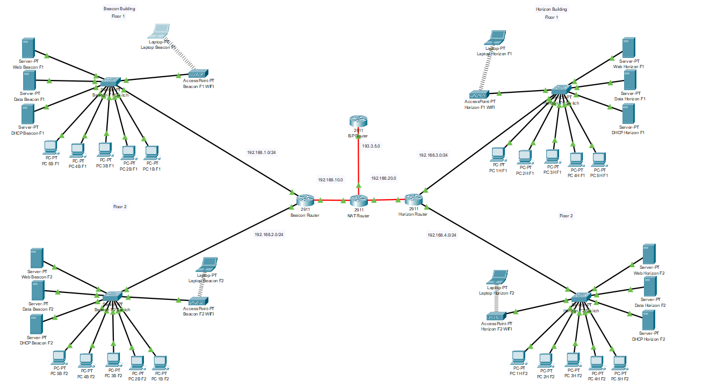

# 🌐 Multi-Building Campus Network Design (Cisco Packet Tracer)

A design and simulation of the network for a fictional electric car manufacturer that has just acquired two buildings, **Beacon** and **Horizon**. Each building has two floors, each floor is a separate department, and every department needs its own network segment with wired and wireless access, its own servers and internet access through NAT.

> Built for the **Network Essentials** module (Bournemouth University, 2024–25). **Grade: 82/100.**



## Project goals

- Choose suitable network devices and plan an IP addressing scheme, including default gateways
- Build and label the full topology in Cisco Packet Tracer
- Set up NAT for internet access and a wireless access point on every floor
- Document every step of the build
- Identify three security weaknesses in the design and propose countermeasures

## Topology overview

| Layer | Devices |
|---|---|
| **Each floor** (×4) | 1 switch, 5 desktop PCs, data server, web server, DHCP server, wireless access point and laptop |
| **Building routers** | Beacon Router and Horizon Router (Cisco 2911), each serving the two floors in its building |
| **Core / edge** | NAT Router (Cisco 2911) linking both buildings, performing NAT and connecting to the internet |
| **Internet** | ISP Router simulating the public internet connection |

Fibre-optic links connect the buildings to the core NAT router.

## IP addressing scheme

| Segment | Subnet | Gateway |
|---|---|---|
| Beacon Floor 1 | `192.168.1.0/24` | `192.168.1.1` |
| Beacon Floor 2 | `192.168.2.0/24` | `192.168.2.1` |
| Horizon Floor 1 | `192.168.3.0/24` | `192.168.3.1` |
| Horizon Floor 2 | `192.168.4.0/24` | `192.168.4.1` |
| Beacon ↔ NAT link | `192.168.10.0/24` | — |
| Horizon ↔ NAT link | `192.168.20.0/24` | — |
| NAT ↔ ISP (public) | NAT `199.3.5.2` / ISP `199.3.5.1` | — |

## Configuration highlights

**Routing**: each building router has a default route pointing to the NAT router:

```
! Beacon Router
ip route 0.0.0.0 0.0.0.0 192.168.10.1

! Horizon Router
ip route 0.0.0.0 0.0.0.0 192.168.20.1
```

The NAT router has static routes back to every internal subnet through the matching building router.

**NAT**: the interfaces facing the buildings are marked `ip nat inside` and the interface facing the ISP is marked `ip nat outside`, so internal traffic is translated to the public address `199.3.5.2`.

**Wireless**: each floor has its own access point with its own SSID (e.g. `Beacon F1`, `Horizon F2`) on a separate channel to avoid interference. Laptops use WPC300N wireless modules.

**End devices**: PCs, servers and router interfaces use static IPs, and each device's default gateway matches its floor's router interface.

## Security analysis

| # | Weakness | Countermeasure |
|---|---|---|
| 1 | Routers and switches left on default settings with no access control | Strong passwords, local user accounts or AAA, and shutting down unused switch ports |
| 2 | Wireless networks could be left unencrypted | WPA2/WPA3 with strong, regularly changed passphrases, plus MAC filtering |
| 3 | No separation between user devices and servers | VLANs to put servers on their own segment, inter-VLAN routing, and ACLs restricting access to the servers |

Further recommendations: regular firmware updates, a firewall at the internet edge, logging and monitoring, and periodic security audits.

## Repository contents

```
├── packet-tracer/campus-network.pkt   # Cisco Packet Tracer simulation
├── docs/Network-Design-Report.pdf     # Full design and implementation report
└── images/                            # Topology screenshots
```

## How to open it

1. Install [Cisco Packet Tracer](https://www.netacad.com/cisco-packet-tracer) (free with a Cisco Networking Academy account).
2. Open `packet-tracer/campus-network.pkt`.
3. Use simulation mode or ping between devices to test connectivity across floors, across buildings and out to the ISP.

## Skills demonstrated

`Network design` · `IPv4 subnetting` · `Static routing` · `NAT` · `Wireless networking` · `Cisco IOS` · `Cisco Packet Tracer` · `Network security`
